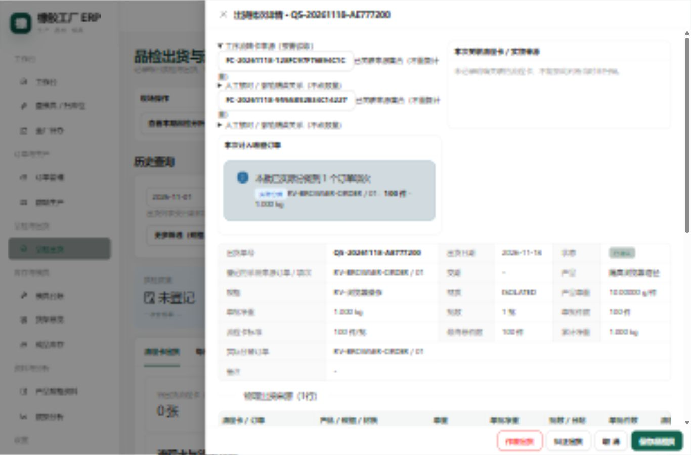

# 工序流转卡：11月18日补修交付与复核

日期：2026-11-18。**本地分支与隔离技术验证交付；未推送、未部署、未迁移正式库，不等于现场试用全部通过。**

本文件是对原《交付与验收.md》的增量记录。原报告保留当时结果；遇到版本、测试或完成情况差异，以本文件和同目录 `evidence-RV.json` 的本轮证据为准。不要把两轮重叠测试数相加。

## 1. 结论摘要

- 已补普通用户模板草稿预览/发布确认、卡组全量分页检索、v2纸面布局、实际二烤多卡/多盘记录、阶段化硬度测法和随烤胶片关联、原图替换入口，以及卡详情少量缺记录/异常提示。
- 本轮实际操作发现并修复了二烤请求号被循环变量覆盖、不同盘共用胶片被错误拒绝、增删卡后胶片代表卡序号漂移、360px日期弹窗横溢，以及Linux字体下温度单位缺字。不是只写报告、未操作页面。
- 后端受影响核心回归379项通过；最终前端5文件25项通过；类型检查、相关ESLint和生产构建通过。Linux独立合成容器验证中文PDF、原图权限、重启及备份恢复。**SQLite并发仍可能返回503，不声称所有请求成功。**
- 浏览器已实际走订单入口、标准确认、制卡、打印任务、整模、一次多卡二烤、手查和来源追溯查看。但出货/退回由隔离API预置后在页面查看，**尚未完成全程仅用页面的闭环，更未完成安卓相机、实印或纸材耐温验收**。RV04保留部分完成。
- 制卡、作业和来源关系不另记数量。原库存/交付/生产算法不变；合成迁移前后旧表摘要一致，不冒充最新正式副本全账核对。正式站仍是基线版本。

## 2. 依据、版本与范围

### 固定依据

| 文件 | SHA256 | 本次使用说明 |
| --- | --- | --- |
| ERP_工序流转卡_交付复核与补修清单_20261118.md | `614b530431adc525c8b0d9739d0222fd7b25591ccbadb63b002c21a8bf8e6821` | 用户确认按RV01-RV08补修；第5、6节为现场补充 |
| 01_ERP_工序流转卡联动实施方案_给Codex_20261117 (1).md | `d1f3f5348d90047733a45b971ac92b535864ee822519795f86524489d9e2fab3` | 含整模补充、FC与A验收编号 |
| ERP_工序流转卡联动_交给电脑Codex_20261117.zip | `f28367a020a95cd2f6dc3f166f8105afff18b428fb0ce157a54ef4be416ecccf` | 本地可取得的包只有旧01-05；未声称已取得复核方提到的新版01-07包。以单独主方案及补修单优先 |

阅读了现有源码、迁移、原交付和相关测试；工作区没有找到AGENTS.md。本轮不假称访问到了全部原始历史会话。

### 代码版本

- 分支：`codex/flow-cards-20261118`。
- 基线/本轮只读核实的正式前后端镜像标签SHA：`baced3ad26519b934a8c7f3b9d0830d45540df0d`。
- 初版功能：`a954fb0`；RV主要补修：`0643998a6df6aa3e3079e978222b2f5b1877e355`。
- 后端前一轮378项测试版本：`0be28b43c73e3df452198e4a46a4bf17624ec75c`。
- 窄屏日期布局和专用隔离来源预置脚本版本：`261d8d79ac2f765cf7d07fb5ec0e3f46dfe3ac98`；该版本实际浏览器操作、前端25项和构建通过。
- **本轮最终运行代码：`a6ec357387fab213f1ae4117157da736985cfb4b`**。在261d8d7基础上仅修v2 PDF温度单位显示并补回归：将绘制的℃等价显示为°C，标准快照仍保原℃，不改旧冻结PDF。最终379项后端、合成数量/性能及最终PDF对应该提交；frontend与261d8d7完全无差异，沿用其测试/截图。
- 此后本地提交仅收录报告、证据、静态辅助预览和交付打包工具。最终证据提交SHA以审阅包 `manifest.json` 的 `evidence_commit` 及分支HEAD为准，避免在提交内部自引用SHA。
- 交付收尾的Git状态：本次跟踪文件全部本地提交；`tmp/`保留原有及本轮PDF渲染临时件，不纳入提交，生成的审阅ZIP也不提交。不能把这些未跟踪产物说成未完成业务代码，也不删除用户可能需要的原临时文件。
- 无push/正式部署。原正式backend与web均运行、健康，启动时间仍分别为 `2026-11-16T03:38:32.699279652Z`、`2026-11-16T03:39:16.542272308Z`；仅查看镜像标签/状态，未读取或输出正式环境密钥。
- 写开关代码默认 `FLOW_CARDS_WRITE_ENABLED=0`；本轮合成环境明确设为1。正式基线没有此新模块，未向正式环境增设或开启该变量。

## 3. RV01-RV08逐项回复

“隔离通过”只针对列出的软件断言；“已实现”不自动等于全部现场验收完成。

| 编号 / 对应原项 | 本轮实现、实际结果 | 证据与剩余边界 |
| --- | --- | --- |
| RV01 / FC03；A11、A12、A25、A31 | `FlowTemplatePanel.tsx`可预览需/不需双版草稿、设置预览毫米尺寸、查看发布历史、明确填写审核依据并确认发布、刷新恢复结果。预览不发卡、不升版；同renderer重复发布仍同版；每卡打印不重复审批；旧卡不套新模板。普通非管理员账号在隔离页面模拟发布版1 | `test_RV01_preview_no_release_then_explicit_publish_once_and_next_renderer`；截图02。后续renderer改版升至2为API模拟测试，不是第二次真实浏览器实印审核。隔离发布文字明确不代表现场实印。真实首次/后续实印审批、发布并发/真丢包仍待验 |
| RV02 / FC00、FC03、FC06；A21、A24、A25、A27、A28 | 同最终运行SHA的Linux候选镜像生成需/不需/长字段中文PDF及原图；独立新容器读取，隔离备份恢复后再次读取，4件原件逐一hash不变。三阶段鉴权200、匿名403；非root、只读rootfs、无网络、无正式数据/端口/密钥挂载 | `rv-evidence/linux-{create,read,restore}.json`及3份Linux PDF。冷构建因DockerHub超时未完成，采用已核实固定缓存base+官方依赖的离线候选构建；不是正式镜像替换，也不是完整生产entrypoint/反向代理发布演练。最新正式副本迁移、全账及维护窗口恢复仍未验 |
| RV03 / FC01、FC03、FC09、FC11；A07-A11、A28-A31 | v2固定人员列和20mm线段；二烤建议/实际左右分区、延长日期/盘号线；关键词浅底；卡号日期段不拆碎；约17mm含净空二维码；补打仅小字次数、0隐藏。尺寸项数未知/0/1分开；实际栏空白。纸张180-220×125-165mm，默认190×130。标准及两阶段对象/量表/方法进入冻结快照；修Linux温度单位缺字 | 四份最终PDF共9页已全部渲染目检；Linux3份共4页另查。`test_RV03_dimensions_and_unknown_scale_preserved_in_frozen_requirements`、`test_RV03_RV06_explicit_objects_not_size_heuristics_and_old_pdf_immutable`、`test_RV03_celsius_display_fallback_does_not_change_snapshot`。所有示例标准非客户真实要求；实际纸毫米、笔写、印刷扫码待验 |
| RV04 / FC01-FC07、FC11；A01、A14、A25、A28、A35 | 真实隔离浏览器普通用户：手机订单卡→完整查看→工序卡→确认要求→制卡→打印任务→整模→实际二烤→完整号手查→卡追溯→出货详情来源→恢复原打印任务/下载PDF。360/390/430/768窄屏日期popup实测无整页横溢，1366出货详情截图 | 截图01-11及 `browser-fixture.json`、`responsive-widths.json`。出货和整批退回是API预置，不写成“浏览器逐步确认全链通过”。真实Android相机、软键盘、WebView下载、微信边界和纯页面全链仍缺；故本项部分完成 |
| RV05 / FC02、FC03、FC05；A04、A12、A13、A18、A26、A27 | 全部卡组分页并按订单/完整卡号/范围搜索；22组的最早组可在第2页找到并手查。20张确认18成功、2未知，续确认仅余2，重复原请求不新建身份/补打。新增无扫码整批退回入口+来源+绑定客户卡+再发组合；保净量及来源。模拟丢响应原key重试 | `test_RV05_*`五项；原A18两轮及105条分页仍通过。最终379项日志实录groups `[201,503]`、generate `[200,503]`、print `[503,201]`；测试验证后续同key恢复及无重复，并非零错误。前一次378项print为`[503,503]`也保留日志，不冒充稳定成功。真实弱网、文件SQLite生产并发、驱动出纸回执未验 |
| RV06 / FC07；A19、A20、A38 | 查到旧产品有二烤参考文本，未找到可直接复用的完整实际二烤台账，故复用 `CardEvent`加最小BAKE事实和 `FlowBakePanel.tsx`。一次可选多卡，每卡明确范围及连续/非连续盘号，填实际人/时间/温度/min，分次/再烤另记，更正保原记录；不要求炉次、不抄第二套量账。随烤胶片保本厂自制/当批料原标识、实际代表卡及盘；烤后测量必须引用有效随烤记录 | 4项 `test_RV06_*`、2项前端安全测试、截图04。实际UI首卡盘1/3/5、尾卡盘7，保存一份BAKE关联两卡成功；不同盘取并集验证不是误用交集。胶片不自动等于成品；不能按同材质扩展覆盖。真实测法与现场盘标识待确认，UI目前一次作业提供一个共同胶片录入区，API可有多份样品 |
| RV07 / FC06；A21、A23 | 原图列表加替换按钮，保新旧原件及替换链，不新增破坏性删除，不因上传完成工序 | `test_RV07_replace_preserves_both_original_bytes_and_audit_no_completion`验证两原件可取、替换关系及审计、整模仍SYSTEM_UNREGISTERED。原图替换尚未做真实手机拍照/页面全流程验证；Linux仅验证独立原图权限及恢复 |
| RV08 / FC08-FC10；A07、A09、A23、A35、A36 | 卡详情区分需整模未登记、不需整模、部分/整包完成及未解决异常；原参数与原人员统计保留，不新增无件数依据排名 | 完整库存来源卡联动、全厂待办改版/人员工序明细、产品经验档案全面分组、OCR/识孔、复杂拆包子卡仍未做。本轮没有以补打代替拆包，也未新增出货硬拦截 |

### 对原验收矩阵的增量修订

原报告A01-A38+A09a共39条仍逐条可查；本轮不重新计算“完成百分比”。其中以下旧缺口已补，仍保留现场限制：

| A项 | 原缺口及现在状态 |
| --- | --- |
| A04 | 最近20组限制：补全量分页搜索，22组/最早组隔离通过；模段重叠仍是明确文本，不是自动区间运算 |
| A08/A31 | v1旧渲染器保留、旧冻结PDF不改；Windows/Linux都可读中文，但不要求跨OS重新生成PDF字节一致，同环境冻结/恢复原件才要求一致 |
| A11 | 补普通用户预览/发布UI、重复与后续renderer版本API测试；实印审批、发布并发仍未完 |
| A13 | 精确覆盖20张/18成功/2未知的状态模拟；不伪造驱动回执 |
| A18 | 第二个无扫码整批退回入口与新来源组合已加测；多轮/长历史沿原服务不变 |
| A19 | 原“未完成”补为隔离软件通过：多卡不同盘、分次/再烤及随烤胶片；真实现场作业联动待验 |
| A21 | 替换链UI已实现及API验证，仍无独立拆包子卡；照片不恢复未知手写内容 |
| A24/A33 | 最终代码重跑合成迁移与旧表逐行摘要一致；部分表为空，最新正式副本未验，不能升级为正式全账通过 |
| A28/A30 | 最终9页Windows与4页Linux视觉检查完成；日期popup四视口实测，仍非真机/实印 |

## 4. 实际页面证据与记录映射

全部为新建隔离库合成资料，无正式出退货，无历史回填。浏览器库与PDF样张库独立，不能把两者ID混用。

| 顺序 | 操作/事实 | 可追溯ID、文件 |
| --- | --- | --- |
| 1 | 普通非管理员账号从手机订单入口查看/进入制卡；确认来源文字、需整模、尺寸0不适用、量表未知留空 | 产品5 `RV-浏览器操作/ISOLATED`；订单5 `RV-BROWSER-ORDER/01`；StandardRevision 5 / version1 |
| 2 | 150模按100模一卡制两张；只生成计划卡，不产生实际产量 | 首 `128fc97f-76e9-4c1c-80a0-c5b01dcff122` / `FC-20261118-128FC97F76E94C1C` /100M；尾 `959ab52e-34c1-4227-8755-d500b421c46d` / `FC-20261118-959AB52E34C14227` /50M；截图01 |
| 3 | UI建打印任务、隔离模拟发布；旧草稿卡不改版 | PrintJob `50b1286a-aaaa-4ca3-b529-d4ebaa32a534`；请求 `cb538ff1-da88-4dff-9e7f-a124481b9634`；截图02。未真实打印，未确认SUCCESS |
| 4 | 首卡整包整模、实际定点0、实际人和15:20 | WHOLE_MOLD event `a2e976cb-d2fc-4123-a171-f3951c18adbd`，UTC07:20；截图03。0是实际填值，不是空白兜底 |
| 5 | UI一次二烤覆盖两卡：首盘1/3/5，尾盘7；150℃、120min、15:30；本厂当批料自制胶片明确代表两卡 | BAKE event `c29ad827-ff77-4810-968b-930e72598da0`，UTC07:30；截图04。仅保存实际作业，不自动生成硬度测量或合格结果 |
| 6 | **API预置**物理100件出货，两来源集合；全退后净交付0 | batch1 `QS-20261118-AE777200`；return1 `R1`。没有客户流程卡时轮次未知，不猜成第一轮；映射在 `browser-fixture.json` |
| 7 | UI完整卡号手查、看退回追溯、跳原出货详情并展开两来源集合 | 截图05、06、07；不代表每客户包与每生产包有精确件数份额 |
| 8 | 360px时间弹窗修正后，390/430/768也测量；原打印任务恢复并下载冻结PDF，未勾选的两卡仍UNKNOWN、任务PENDING | 截图09是修复前，仅作反例；10是修后；11是恢复后。截图08处于弹窗动画过渡，不能单独当完整二烤表单布局证据。以04/10及DOM测量为准 |



## 5. 数量、快照与业务边界

以下均为隔离断言，不是正式客户账的重新确认：

1. **制卡不记数量**：2050模÷100生成21张，首/中100M、尾50M；只是计划包。定点记录不再扣孔，400总孔/396有效孔已有4定点，再登记4仍396；不推算报废件。
2. **来源不乘交付**：原测试甲50+乙50=物理100；挂两来源卡后仍100。下一次100再次关联原来源卡，总200，不翻倍。精确来源份额未知就显示集合，不造包余额。
3. **多轮不造返工**：原测试100→全退→再发→全退→再发，最终净有效交付100；物流事件不新增实际返工作业，0条作业只表示系统未登记。
4. **库存和客户交付不混账**：待检库存200人工出100后余额100、交付0；随后客户品检出100并绑卡，交付100、库存仍100，没有第二次扣减。这不是已实现逐件库存来源关联。
5. **本轮来源样本**：一次100出货→全退100，净量100→0，两来源集合不改回冲。仅API预置；没有借此猜配正式340、215或其他旧账。
6. **最终代码合成迁移**：`rv-evidence/isolated-quantity-performance.json`记录旧应用合成产品、两个订单、396孔任务及100模日志；迁移前后、制卡/100条工序后，旧业务表逐行hash与行数相同；1/100来源绑定前后旧表也相同。部分库存/退回表为空，不能代替最新正式副本全账核对。
7. **冻结**：标准、方法/对象、需整模、实际模具图及孔数口径、纸型和模板按卡组快照保留；改产品标准不改旧卡/原PDF。下载读取冻结字节，不用当前渲染器重造原件；v1与v2不能混打一任务。
8. **测量含义**：实测0、未测、不适用、未知、接口失败分别保留。胶片不是成品；对象/量表/单位/方法不匹配时保原值并NOT_EVALUATED，不假判合格。方法变化留更正链，不抹旧值。

## 6. 测试命令、实际范围和性能

### 最终自动验证

```powershell
# cwd: backend；独立Django测试库，不指定正式库
D:/develop/venvs/erp/Scripts/python.exe manage.py test quality inventory flowcards molds.tests.test_management_commands --noinput
# 379 passed，112.892s；最终a6ec357。

# cwd: frontend；Node22，包含真实存在的5个文件
node node_modules/vitest/vitest.mjs run src/components/FlowBakePanel.test.tsx src/pages/FlowCardsPage.test.tsx src/flowcards.test.ts src/components/InternalShipmentTrace.test.tsx src/pages/OrdersPage.test.tsx
# 5 files / 25 passed，71.63s，261d8d7；frontend与最终a6ec357无差异。

node node_modules/typescript/bin/tsc -b
node node_modules/vite/bin/vite.js build
node node_modules/eslint/bin/eslint.js src/components/FlowBakePanel.tsx src/components/FlowBakePanel.test.tsx src/pages/FlowCardsPage.tsx
# 均退出0，Vite 8.54s；约909.72KB主chunk提示仍在。

# cwd: backend；只对隔离库读取结构
python manage.py check
python manage.py makemigrations --check --dry-run
# 无系统错误、无遗漏迁移。本轮补修无新增迁移；初版0001/0002保留。

# cwd: repo；必须使用不存在的新文件，拒绝已有库
python scripts/flowcards_acceptance.py --database .codex_tmp/flowcards-NEW.sqlite3 --report .codex_tmp/quantity-NEW.json
```

证据日志：`rv-evidence/backend-379.txt`、`frontend-25.txt`、`frontend-build.txt`。前端JSDOM有CSS/伪元素不支持提示，不能替代视觉验收。本轮未重新跑原785项全后端或388项全前端；原报告数字不冒充本轮通过数。前一版单独flowcards 53项也通过；最终新加1项单位显示测试，flowcards共54项已包含在379中，不另相加。旧378项日志保留为历史，不冒充最终结果。

最终后端日志原生重定向中部分中文出现编码丢失；英文测试计数、耗时、结果及并发HTTP状态完整保留。合成测试账号占位密码已隐去，不将日志中文损失当产品错误，也不声称已恢复损坏文字。

早期前端命令含不存在的 `InternalShipmentSources.test.tsx` 会被Vitest忽略，不能算测试文件；最终命令已剔除，明确含OrdersPage，结果为5文件25项。补测过4文件10项也不相加。

### 只读性能：最终代码合成样本

Windows本地SQLite、Django APIClient，无HTTP/TLS、网络、相机或页面绘制。120张卡、同卡新增100条事件，各读20次。P95为排序第19项；不是上线前后公网对比。

| 读路径 | P50 ms | P95 ms | 最大SQL | 最大字节 | 错误 |
| --- | ---: | ---: | ---: | ---: | ---: |
| 内码scan，无历史 | 0.914 | 1.172 | 1 | 520 | 0/20 |
| 同卡scan，100事件后 | 0.874 | 0.984 | 1 | 520 | 0/20 |
| 详情，100事件后 | 2.575 | 2.751 | 5 | 1965 | 0/20 |
| 事件分页20条 | 2.018 | 2.405 | 3 | 7491 | 0/20 |
| 卡组100卡（快照共用） | 2.767 | 3.120 | 3 | 30645 | 0/20 |

20/100张生成分别126.836/65.843ms、20/21条SQL；1/100张来源绑定34.498/50.929ms、8/9条SQL，前后原账摘要均一致。合成迁移1028.941ms。这些单次写操作耗时含预热/锁等波动，不能根据100张单次比20张快推断性能线性。旧版正式站不存在内部卡同路径，不能编造“旧版降到本版”的百分比。真实扫码2秒目标仍未验，工具及现场单已交付。

SQLite争用：最终日志中groups `[201,503]`、generate `[200,503]`、print `[503,201]`；前次print为`[503,503]`。断言验证同key恢复、唯一性和无孤儿；不是所有并发请求都成功。不要对正式站做POST压力或断网写测试。

## 7. Linux候选与持久化证据

- 最终候选 `erp-flow-review:a6ec357`，固定运行SHAa6ec357；镜像及源码tar完整摘要见 `evidence-RV.json`。261d8d7候选为前一轮，不能替代最终单位显示修复验证。
- 冷构建 `deploy/backend.Dockerfile` 因DockerHub python基础镜像超时未完成；不把网络失败说成业务代码错误。保留该限制。
- 离线补验复用已核实的不可变缓存base `sha256:de0979b16fd26711c48eafc21b05228ad65cca993206df3f1ad375a7b35d09db`，独立tag，不替换正式latest。安装官方Debian中文字体及PyPI reportlab4.4.5，再COPY本分支backend；脚本 `scripts/flowcards_review_overlay.Dockerfile`。
- 字体deb SHA256 `239163df984eea5c9da3b551aee374936222cdbd67f1a1be3cdcf3d76143ad66`；reportlab wheel `849773d7cd5dde2072fedbac18c8bc909506c8befba8f088ba7b09243c6684cc`。不改宿主机字体/运行库。
- `scripts/flowcards_linux_check.py`用专用 `/probe` 合成存储，三次新容器执行create/read/restore；非root10001、只读rootfs、network none、无公开端口、不挂正式数据/密钥。探针明确覆盖entrypoint直接调用Python；不冒充完整生产启动部署。
- create全新迁移→需整模/不需/长字段PDF和原图→复用 `backup_erp`；read重开容器读取同件；restore到全新隔离目录读取同件。三阶段4件逐一hash一致，鉴权200、匿名403。
- 最后重新固定最终SHA时，首次探针沿用生产entrypoint，因只读隔离没有 `/app/data` 退出；未写正式目录。随后按探针目的明确 `--entrypoint python` 重跑成功；该初次退出不隐去，也不当作完整启动已验。
- Windows SimHei与Linux文泉驿字形不同；各自产物可读不等于跨OS重新渲染字节相同。要求的是同一个冻结原件重启/恢复后hash不变。
- 最终视觉检查实际发现文泉驿环境的℃符号没有完整显出；仅在v2绘制阶段规范为等价的°C，不换算数值、不改标准单位、旧渲染器或旧冻结PDF。补单位显示/快照不变测试并重跑379项，再生成最终双平台样卡。
- 最新真实生产副本迁移、真实多目录维护窗口恢复、正式反向代理与移动下载尚未验。原 `evidence.json` 的旧合成结果不替代它们。

## 8. 新现场说明及仍待核实内容

### 纸卡随货入炉

卡面改为中性“随货流转 · 异常同号续记”，不继续把“纸卡不入炉”当全厂硬规则；防混料身份和每卡实际盘号对应保留。不要求重买纸，不设计233℃自动允许开关，不指导升温找燃点。

已买32开160g纸、常用150℃/最高约180℃，**长期适用性未验证**。需供应方核对本批纸、实际最长时间、实际卡片位置/接触、印字/签字及卡套胶带夹具等组合。纸重不是耐温认证，一次未燃烧也不是长期许可。软件补修不替代材料/设备安全判断。

### 手持硬度计与成品/胶片

两个阶段分别选成品/胶片/待确认，量表、仪器、测点、试样、调节、读数时间、取值和认可方法可空，一次配置后随标准快照，不要求工人每张重抄。3×1.5、100×10均可人工配置胶片，普通产品可选成品；不按尺寸阈值猜，不猜Shore A，不推断0.176×0.07的单位。

本厂自制、当批胶料、胶片随对应产品二烤已作为现场做法采用，不再反复提问。仍缺仪器型号/量表、具体制样及客户认可方法；未补齐允许真实记录，但不伪判合格。一次共用胶片只一条实测事实、明确覆盖所选卡；未随烤部分不能带烤后值，不把旧胶片读数改名为成品实测。

## 9. 交付文件、后续顺序与停止边界

1. 本报告、`evidence-RV.json`、`rv-evidence/`为新增证据，原报告不被改写成新结果。
2. `现场验收补充操作单.md`给出纯页面闭环、真机相机/键盘、两次模板发布、20/18/2打印、纸材及测法的现场步骤和记录表；原只读测速脚本可复用。
3. 四份 `output/pdf/工序流转卡_RV_*.pdf`：完整要求需/不需各3页，缺要求1页，长字段续页2页；全部合成、草稿，不是正式客户标准。完整要求来自确认标准→卡组冻结→打印服务，不在renderer里写示例常量。
4. 审阅ZIP包含基线后的Git增量bundle、可读diff、变更源码、报告/证据和4份PDF；不含真实数据库、私有原件目录、环境文件或正式凭据。manifest固定运行SHA、证据提交及各项hash。bundle依赖上述基线，不是整库备份。
5. 收尾后只停止本轮本地测试服务并退出SSH；不停止正式站。测试材料/候选镜像可保留供复核，不自动清正式数据。
6. **下一步先用户审阅，再决定独立测试部署和少量试点。**待补RV04纯页面闭环、真机/实印、正式副本核对及发布流程现场验收；不以这些缺项搁置已完成的软件证据，也不说“全部完成可正式上线”。

仍未做FC08完整库存/人员/全厂待办、FC09全面经验档案、FC10 OCR/复杂拆包；不扩张本次范围。原退回再出货流程和单订单状态规则不改，不引入被用户否决的复杂双状态或额外返工流程。
